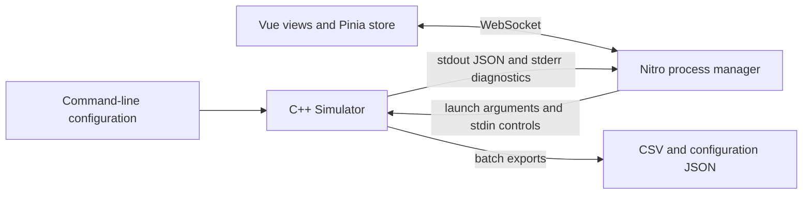

# Implementation architecture

TSVRA combines a C++20 cycle simulator with a Nuxt browser application. The browser runs the same simulator executable as command-line experiments; Nitro translates WebSocket controls into stdin commands and forwards stdout JSON. This document retains the useful architecture material from the former developer guide, checked against the current implementation.



## Native modules

Public interfaces live in [`include/`](../include/); implementations live in [`src/`](../src/).

| Module | Responsibility |
|---|---|
| [`main.cpp`](../src/main.cpp) | Parse and validate configuration, initialize and run the simulator, then export batch results. |
| [`config.cpp`](../src/config.cpp) | Native defaults, INI parsing, CLI overrides, validation, help and configuration serialization. |
| [`grid.cpp`](../src/grid.cpp) | Layer geometry, vertical channels, redundancy coverage and spare selection, frozen failure probability maps and scheduled runtime failures. |
| [`tsv.cpp`](../src/tsv.cpp) | Resource health, redundancy flag, availability time and active path usage. |
| [`router.cpp`](../src/router.cpp) | A* routing with physical hop/wait timing, optional congestion/risk weights, route limits and spare bypasses. Compressed bypass segments are expanded into adjacent hops. |
| [`request_generator.cpp`](../src/request_generator.cpp) | One global Bernoulli request trial per generation cycle, traffic-weighted region sampling and non-spare endpoints. Sources are on lower layers; destinations are on the top layer. |
| [`simulator.cpp`](../src/simulator.cpp) | Generation, hop execution/reservations, failure handling, rerouting, event collection, power accounting and stream controls. |
| [`statistics.cpp`](../src/statistics.cpp) | Delivery/latency/failure counters, horizon/end in-flight counts, power snapshots and CSV exports. |
| [`power_model.cpp`](../src/power_model.cpp) | Load physical coefficients from `power_model.ini`, count executed events and compute energy and simulation-time average power. |

The grid width and height are `4 * grid_factor`, divided into 4×4 traffic regions. Routing nodes exist on every layer, but a vertical channel is stored at its lower endpoint and connects `z` to `z + 1`. There are `grid_size² * (num_layers - 1)` logical vertical channels. Top-layer nodes are not additional channels. Redundancy layouts are `shared` (the native and browser default), `corner4` and `none`; see [problem-setting.md](problem-setting.md) for their geometry.

Traffic region weights and failure hotspots serve different purposes. Traffic weights affect endpoint sampling. Uniform or fixed Gaussian failure maps affect channel failure probabilities. Separate random streams for traffic, initial faults, runtime faults and fault centers derive from the recorded actual seed. See [failure-model.md](failure-model.md).

## Shared simulation loop

[`Simulator::run()`](../src/simulator.cpp) uses the same loop for CSV and JSON modes. The configured cycle count is the **request-generation horizon**. After that horizon, simulation continues until pending and transmitting requests finish or fail; runtime failures and power accounting continue during this drain period. A graceful stop can finish earlier and retains partial results.

Each cycle runs in this order:

1. Generate at most one request, while within the generation horizon.
2. Advance transmitting requests, including resource waits, launched hops and reroutes.
3. Apply runtime failures, except in initial-only failure mode.
4. Route pending requests.
5. Update power statistics and emit the cycle message or batch progress.

Power events are charged for actual launched router/link activity. Selecting a route or waiting for a resource does not itself count as a transmitted hop. All power and energy use simulated elapsed cycles and configured frequency, including drain. Browser playback speed does not affect them. [power-model.md](power-model.md) describes the active model and calibration evidence.

Without `--json-stream`, the program writes summary, request and power CSV files plus a configuration JSON file under the selected output prefix. Stream mode sends `init`, `cycle` and `done` JSON lines instead of these batch exports. The stream includes power snapshots and exact parameter provenance. See [web-visualization.md](web-visualization.md) for the protocol.

Native configuration files load only when selected with `--config`; command-line values override loaded files regardless of argument order. `--print-defaults` reports the resolved native configuration. The browser has its own launch defaults, so a native run with no overrides does not imply the browser settings.

## Browser and server responsibilities

The application in [`web-nuxt/`](../web-nuxt/) uses Nuxt in SPA mode, Vue, Pinia, Three.js, Chart.js/vue-chartjs and Tailwind. Both Nuxt and Nitro enable the experimental WebSocket option in [`nuxt.config.ts`](../web-nuxt/nuxt.config.ts).

| File | Responsibility |
|---|---|
| [`shared/simulationConfig.ts`](../web-nuxt/shared/simulationConfig.ts) | Browser launch defaults, configuration validation, manual-center parsing and native argument serialization. The form and server share validation. |
| [`server/api/_ws.ts`](../web-nuxt/server/api/_ws.ts) | One simulation manager per WebSocket peer; validate launches and ack bounds, forward events, and handle controls/disconnects. |
| [`server/utils/simulationManager.ts`](../web-nuxt/server/utils/simulationManager.ts) | Locate the executable and working directory, spawn with separate argument strings, parse stdout lines, forward stderr and write stdin controls. |
| [`composables/useWebSocket.ts`](../web-nuxt/composables/useWebSocket.ts) | Connect/reconnect, dispatch messages to the store, grant cycle credits and schedule browser playback. |
| [`types/simulation.ts`](../web-nuxt/types/simulation.ts) | Types used by the frontend for launch settings, events, running statistics and power. Native emitters also supply provenance and terminal fields that the UI does not consume. |
| [`stores/simulation.ts`](../web-nuxt/stores/simulation.ts) | Own grid/request state, cumulative path occupancy, failure positions, bounded chart histories, summaries, connection/error state and UI choices. |
| [`shared/power.ts`](../web-nuxt/shared/power.ts) | Convert native snapshots into average/interval chart samples using simulated time; bound history to 500 samples. |
| [`pages/index.vue`](../web-nuxt/pages/index.vue) | Shared layout, view visibility, error/loading/stale-data banners and stderr panel. |
| [`components/layout/ControlPanel.vue`](../web-nuxt/components/layout/ControlPanel.vue) | Start configuration, pause/resume/step/stop/reset, speed and heatmap update controls. |
| [`composables/useBuildQueue.ts`](../web-nuxt/composables/useBuildQueue.ts) | Serialize expensive scene construction across the Three.js views. |

The server validates configuration before spawning. It resolves `TSVRA_BIN` first, then common `bin/` and `build/` locations, including Windows configuration directories. `TSVRA_ROOT` can set the child working directory; otherwise the manager searches near the executable/current directory for `power_model.ini`. The server needs that active configuration file as well as the executable.

A start replaces an existing process for the same connection. JSON mode starts paused, and browser acknowledgements grant a bounded batch of cycles. Pause and speed changes clear unused credits; cycles already executed still reach the store. Stop sends `s` and waits for a partial `done` summary. A replacement run or disconnected client terminates the old process with `SIGTERM`. Reconnecting creates a new connection rather than reattaching to the previous simulation.

## State and rendering

The store resets run data before launch and again on `init`, then rebuilds the authoritative grid from native data. Large grids and traffic arrays use `shallowRef` with explicit `triggerRef`; active requests use a shallow Map. Cycle processing applies new requests/reroutes before removing completed or failed requests, preserving a reroute that completes in the same cycle. Rerouted paths remain visible for 1,000 simulated cycles after termination.

The browser marks both endpoint layers of a failed channel for display, while preserving its lower-layer position in the failure list. Those display markers do not represent two failed channels. Latency samples retain the latest 10,000 completions; chart histories retain the latest 500 entries and reset for each run.

| View | Current behavior |
|---|---|
| [`DashboardView.vue`](../web-nuxt/components/dashboard/DashboardView.vue) and [`PowerPanel.vue`](../web-nuxt/components/dashboard/PowerPanel.vue) | Delivery/latency KPIs and charts, component power, energy, interval/cumulative averages and calibration metadata. |
| [`Grid3DView.vue`](../web-nuxt/components/grid3d/Grid3DView.vue) | Instanced meshes per layer, OrbitControls, type/traffic/status colors, 4×4 region boundaries and rerouted path lines. |
| [`HeatmapView.vue`](../web-nuxt/components/heatmap/HeatmapView.vue) | Per-layer cumulative route-coordinate density; falls back to traffic weights before routes are observed. This is a visualization of selected paths, not executed-hop telemetry. |
| [`FailureView.vue`](../web-nuxt/components/failure/FailureView.vue) | Failure markers and cumulative count chart, failure distribution metadata and optional hotspot centers/radius markers. |
| Quad view | The same four components shown together in the main page; all consume one store. |

Renderers manage scene construction, animation, resizing and disposal. Hidden views stop their animation loops. The store still processes every cycle; native `updateVisuals` and the configurable heatmap interval limit expensive visual updates. Three.js maintenance details are in [threejs-instancedmesh-notes.md](threejs-instancedmesh-notes.md).

## Build and verification entry points

[`CMakeLists.txt`](../CMakeLists.txt) builds a shared static library, the simulator and native test executables using the configured C++20 toolchain. It selects compiler flags for MSVC, GCC or Clang; no repository-specific GCC installation is required. Runtime binaries are placed in `bin/`.

From the repository root:

```bash
cmake -S . -B build
cmake --build build --config Release
ctest --test-dir build -C Release --output-on-failure
```

Native tests cover routing/delay behavior, failure models and power; Python integration tests registered with CTest cover CLI/JSON consistency and streaming controls when Python is available. From `web-nuxt/`, `npm test` checks configuration/state/power helpers, `npm run build` builds the app, and `npm run test:integration` checks the built WebSocket server with the compiled simulator. Setup details and platform requirements are in the [root README](../README.md).
