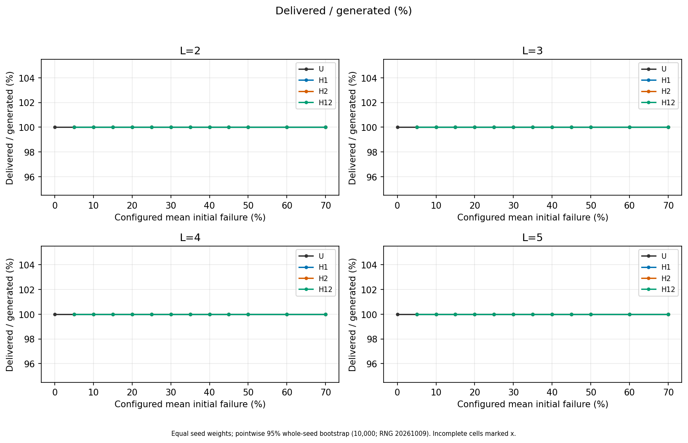
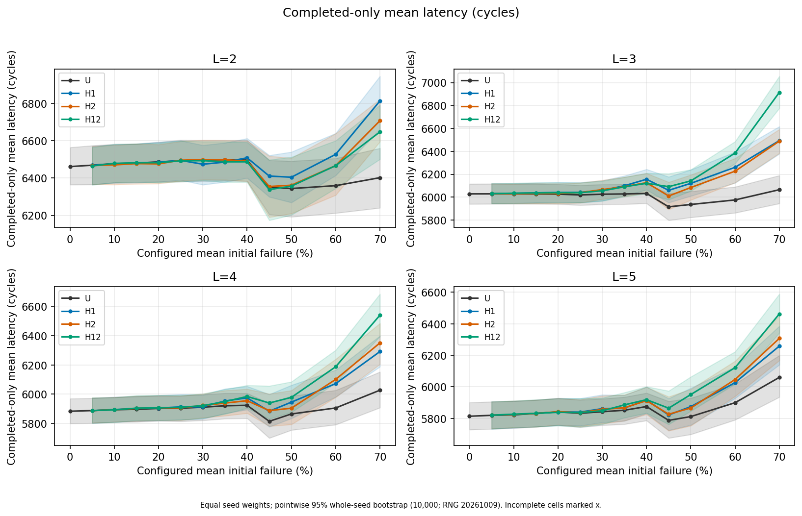
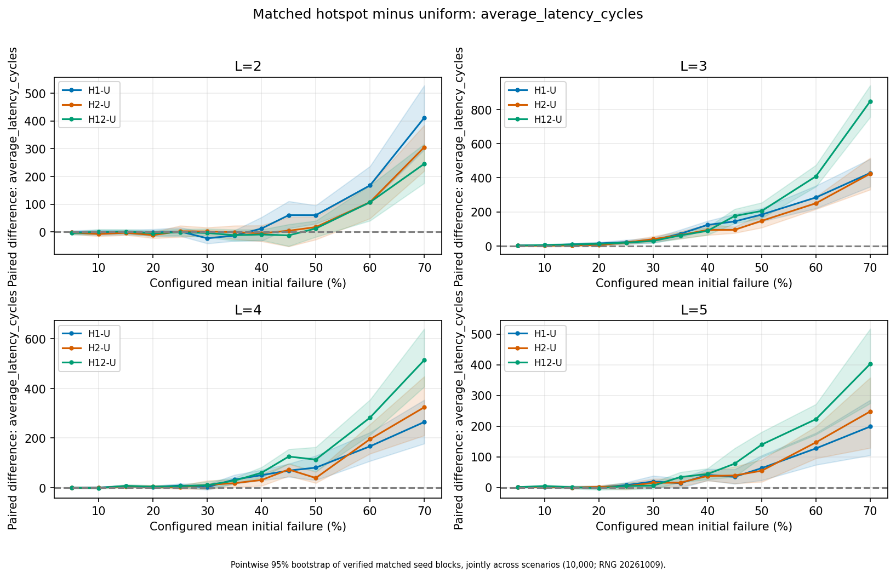
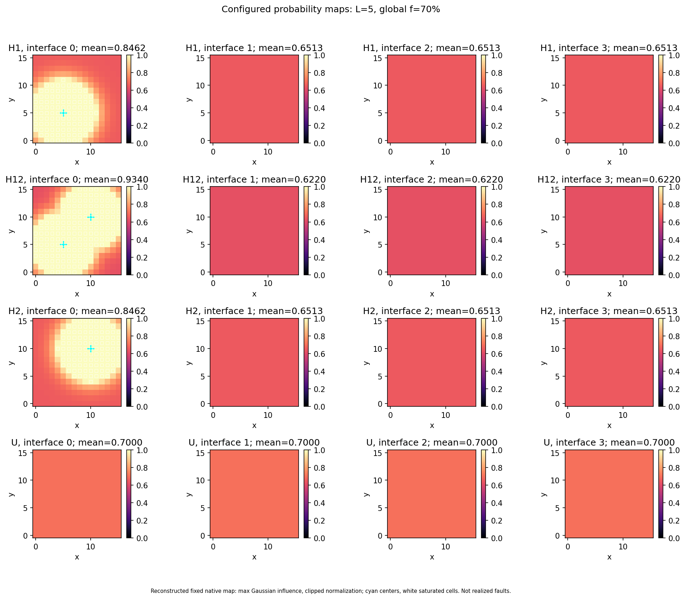
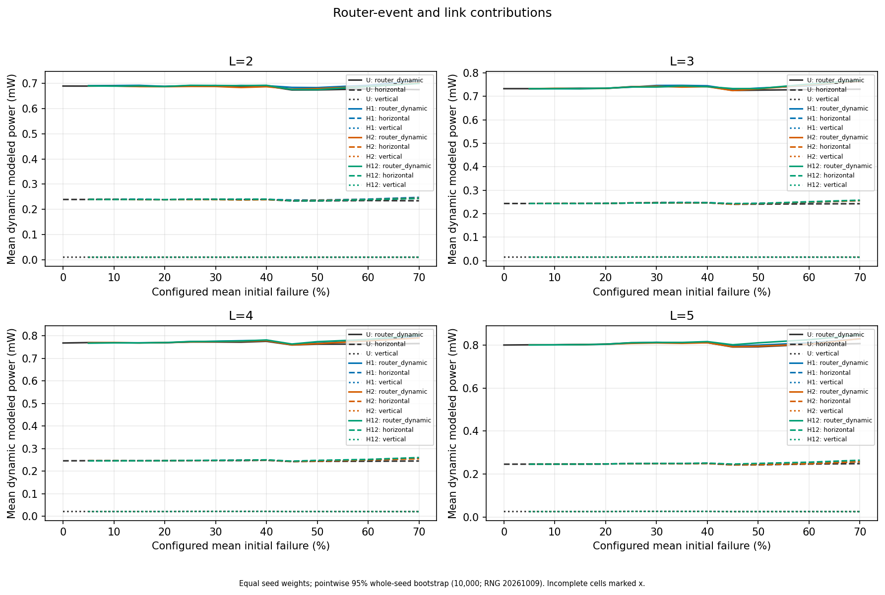
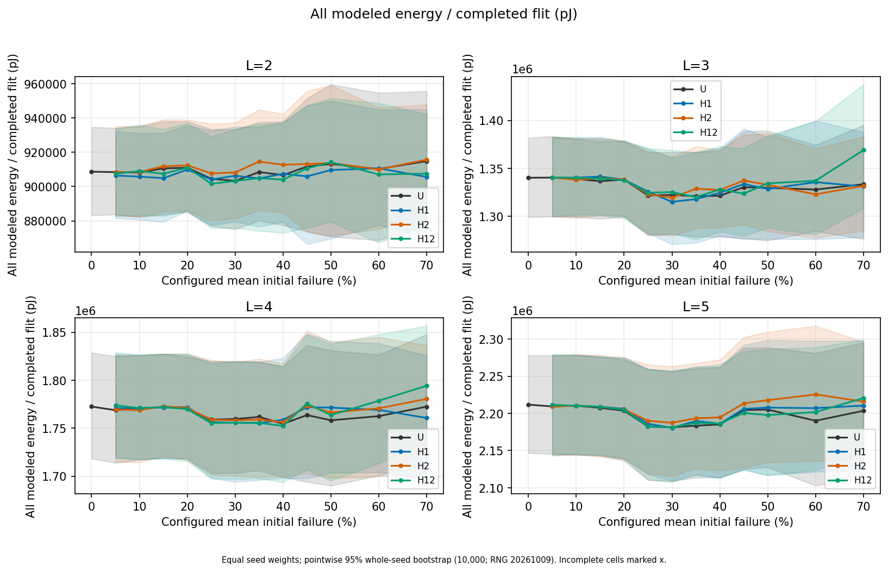
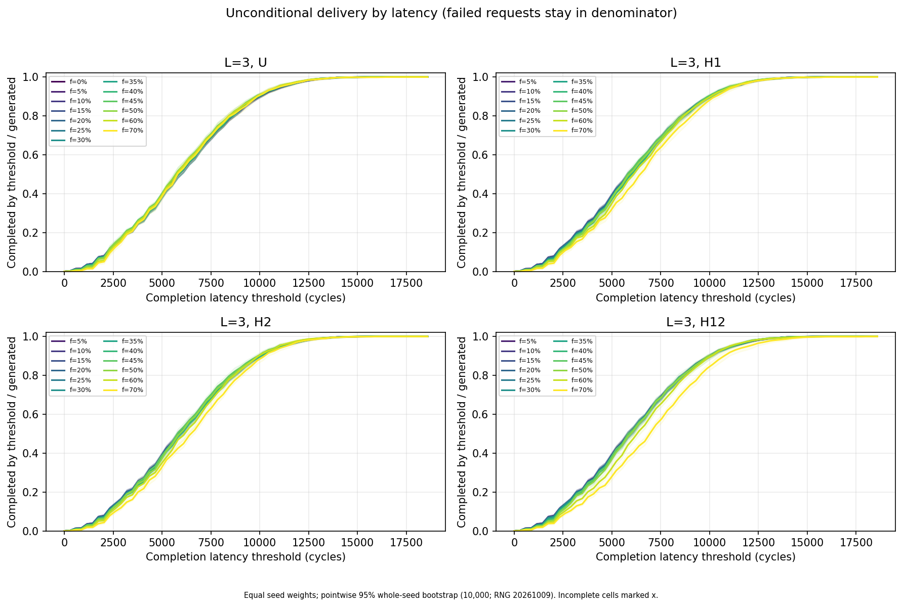

# TSVRA experiment report

**Study completed: 9 October 2026.** This report presents the completed failure-rate, layer-count and spatial-defect study. The [experiment plan](experiment-plan.md) retains the approval decisions and full execution history. Tables and selected figures accompany this report in [experiment-results/](experiment-results/README.md).

## 1. Main findings

All **4,116 planned runs** passed validation: 156 pilot runs and 3,960 main runs. The main study contains **196 complete cells** and **811,488 generated flits**, all of which completed after full drain.

Under the declared workload and routing assumptions, delivery remained at 100% throughout the 5–70% configured defect sweep. At 70%, every hotspot scenario had higher mean latency than its matched uniform control; the twelve paired increases ranged from **198.4 to 849.0 cycles**, or **3.27–14.00%** relative to uniform. The largest penalty was H12 at three layers: **848.99 cycles**, with a pointwise 95% interval of **[756.30, 942.17]**.

Router idle power supplied at least **99.988494%** of cell mean total modeled power. Defect-sensitive event/link contributions were much smaller. Energy per completed flit depended strongly on drain duration, so the latency results do not imply a universal energy ranking.

The visible latency drop at the 45% rate boundary mainly reflects the change from twenty seeds to ten. Matching the seed sets reverses fourteen of the sixteen displayed decreases to increases. This sampling effect is documented rather than interpreted as a benefit from additional faults.

These findings characterize the simulator and its reference architecture coefficients. They do not measure physical chip yield or silicon power. Numerical results below use main-study seeds; pilot results serve the operational review.

## 2. Study design and measurements

### 2.1 Geometry, workload and fault scenarios

| Setting | Executed value |
|---|---|
| Planar grid | 16×16 per layer (`grid_factor=4`) |
| Layers | 2, 3, 4 and 5 |
| Logical vertical channels | 256(L−1), including spares; top-layer routers add no channels |
| Router population | 256L |
| Spare layout | Shared; 25 spares per interface |
| Generation horizon | 10,000 cycles, followed by full drain |
| Traffic | One global Bernoulli injection trial/cycle, probability 0.02; about 200 flits/run in expectation |
| Flit size/endpoints | 64 bits; sources on layers 0…L−2, destinations on layer L−1; native spatially weighted generator |
| Link/router delays | Vertical 5, horizontal 500, router 15 cycles/hop |
| Routing | `lambda1=lambda2=0`; path length, horizontal-distance and reliability limits disabled |
| Fault timing | Initial only; runtime failure probability 0 |
| Power coefficients | Unchanged `code/config/power_model.ini`; 1 GHz mapping, one cycle = 1 ns |

A configured failure fraction f is the mean initial defect probability across **all logical vertical channels**, including spares. An individual run's observed failed fraction is a stochastic measurement. A defect disables the vertical edge between z and z+1 in both directions; its coordinate uses the lower interface z.

| Scenario | Failure distribution | Manual centers |
|---|---|---|
| U | Uniform control | None |
| H1 | One Gaussian hotspot | (5,5,0) |
| H2 | One Gaussian hotspot | (10,10,0) |
| H12 | Two Gaussian hotspots | (5,5,0) and (10,10,0) |

All hotspots use radius 3 and multiplier 5. Multiple centers combine through the **maximum Gaussian influence**. Clipped probabilities are normalized to preserve global mean f and remain frozen throughout the run. H12 does not sum two independent failure rates. Point 1 occupies an ordinary-channel position; point 2 aligns with a shared spare. Their comparison therefore includes spare-layout alignment.

### 2.2 Run budget and replication

| Stage/band | Configured rates | Seeds per cell | Runs |
|---|---|---|---:|
| Pilot faults | 5%, 30%, 70% × 4 layers × 4 scenarios | 901–903: 3 | 144 |
| Pilot healthy control | 0%, U only × 4 layers | 901–903: 3 | 12 |
| Main low | 5%, 10%, 15%, 20% × 4 layers × 4 scenarios | 101–130: 30 | 1,920 |
| Main middle | 25%, 30%, 35%, 40% × 4 layers × 4 scenarios | 101–120: 20 | 1,280 |
| Main high | 45%, 50%, 60%, 70% × 4 layers × 4 scenarios | 101–110: 10 | 640 |
| Main healthy control | 0%, U only × 4 layers | 101–130: 30 | 120 |

The main matrix has 192 fault cells plus four healthy cells. Pilot and engineering fixtures are excluded from main estimates. Each **whole seed run** is an independent replication unit; requests within a run share faults and contention.

Primary tables weight valid seed runs equally. Supplementary pooled success, latency and energy/completion divide summed numerators by summed denominators and are separately labeled in the [complete summary](experiment-results/tables/summary.csv).

Pointwise 95% intervals use 10,000 whole-seed percentile bootstrap resamples, PCG64 analysis seed **20261009**, and NumPy linear quantiles. Hotspot−U comparisons resample common seed blocks jointly across scenarios after verifying exact traffic at fixed L/layout/seed. Endpoints are not paired across layer counts. The intervals are descriptive and do not establish simultaneous significance or equivalence.

### 2.3 Metric definitions

| Metric | Definition |
|---|---|
| Observed failed fraction | Failed TSV channels / [256(L−1)]; failed spares are already a subset |
| Delivery success | 100 × completed/generated after full drain |
| Completed latency | Completion time − generation time, including dispatch, waits and rerouting |
| Median / p95 | Median averages the central two samples for even counts; p95 uses nearest rank ceil(0.95 × completed count) |
| Dynamic modeled power | Router-event + horizontal-link + vertical-link mean power |
| Total mean power, mW | Total energy in pJ / (elapsed seconds × 10⁹), over generation plus drain |
| Energy/completed flit, pJ | All modeled energy / completed, including idle energy and launched traffic |
| Drain duration | Elapsed cycles − 10,000 |

Failed completion times/latencies remain undefined. Zero-completion latency and energy/completion remain blank/null; zero-traffic success remains undefined. No main run encountered either case. Whole-run power is retained in the run sheet and is not allocated to individual requests.

## 3. Correctness and execution evidence

| Check | Outcome |
|---|---|
| Required native CTest registrations | Four present and four passed; final gate 6.53 seconds |
| Batch, analysis and pilot-review fixtures | 32 passed: 13 batch, 16 analysis, 3 pilot-review |
| Frontend helpers | 10 passed |
| Frontend production build and WebSocket integration | Passed |
| Probability/routing/replay checks | All 192 planned map profiles, geometry/spares, clipping, Gaussian maximum/locality, frozen maps, explicit route fixtures, waits/runtime reroutes and full canonical replay covered |
| Run acceptance | Unique terminal IDs, timestamp/count reconstruction, zero final occupancy, exact effective settings and independent energy recomputation required |

The [main audit](experiment-results/metadata/main-audit.json) and [pilot audit](experiment-results/metadata/pilot-audit.json) record zero missing, failed or invalid runs. Independent review checked all raw bundles, command/configuration hashes, matched traffic and power identities; maximum relative energy residual was 5.76×10⁻¹⁶. No simulator algorithm or power-coefficient change was required.

| Execution item | Pilot | Main |
|---|---:|---:|
| Accepted/planned runs | 156/156 | 3,960/3,960 |
| Complete cells | 52/52 | 196/196 |
| Generated/completed flits | 33,072/33,072 | 811,488/811,488 |
| Failed/missing/timed-out/retried runs | 0 | 0 |
| CPU jobs | 1 | 4 |
| Batch wall time | 5.836 s | 378.711 s |
| Bytes recorded at batch completion | 16,204,951 | 402,884,154 |

Pilot run wall times averaged 0.03520 s, with maximum 0.09951 s. Generated counts ranged from 199 to 223; drain duration ranged from 10,934 to 17,340 cycles. An excluded engineering benchmark measured 3.6855× speedup at four jobs, supporting that concurrency and a conservative 30-second main timeout. Scientific settings and repetition budgets remained unchanged.

The forecast of 37.423 seconds underestimated main batch time by **10.12×**. Mean child CPU remained approximately 0.0264 seconds/run versus 0.0278 in the pilot, so batch/report/directory-scan overhead is a plausible explanation; its contribution was not profiled. Main analysis took 190.273 seconds and peak RSS 2,419,112 KiB. Per-job `wait4` RSS also includes inherited Python memory before `exec`, so it is not native-only simulator RAM.

The frozen implementation is revision `8d14413ba4b635f8d359094e3f0c9cc35ff01d11` plus archived changes. Pilot/main source, executable and power-file hashes match. Execution used Release C++20/GCC 14.2.0, CMake 3.31.6, Python 3.13.5, Node 24.21.0, NumPy 2.2.6 and Matplotlib 3.10.7 on an AMD EPYC 7532 server with 32 exposed cores and about 31 GiB RAM. Detailed hashes, versions, commands and logs are linked in [the execution record](experiment-plan.md#101-correctness-and-frozen-implementation).

## 4. Results

### 4.1 Delivery and healthy controls

Every main run delivered 100% of generated traffic and ended with zero requests in flight. All 196 cells have defined latency and energy/completion in every seed. Success intervals are consequently degenerate [100%,100%]; this records sample saturation rather than certain reliability.

With healthy horizontal meshes and unconstrained routing, an interface that retains a healthy vertical crossing can provide an alternate path. This connectivity explanation is consistent with the observed delivery. High logical-channel defect fractions therefore show their effects mainly through detours, waits and energy in this experiment.



*Figure 1. Delivery after full drain, shared 16×16 layout, global injection 0.02 and initial-only faults. Each cell has 30/20/10 seeds in the low/middle/high bands; healthy U has 30. Ribbons are pointwise whole-seed 95% intervals from 10,000 resamples; all cells are complete. [PDF](experiment-results/figures/delivery_vs_failure.pdf).*

Healthy uniform controls use 30 seeds per layer. Latency values below are means of per-run completed means; brackets contain pointwise 95% intervals.

| L | Mean latency [95% interval], cycles | Mean total power, mW | Mean energy/completed flit, pJ |
|---|---|---|---|
| 2 | 6,461.6 [6,364.6, 6,564.3] | 8,426.2808 | 908,661 |
| 3 | 6,029.0 [5,940.9, 6,116.2] | 12,639.0041 | 1,340,059 |
| 4 | 5,882.9 [5,799.1, 5,969.7] | 16,851.7185 | 1,772,582 |
| 5 | 5,813.7 [5,728.6, 5,901.1] | 21,064.4263 | 2,211,718 |

Healthy latency decreases with L in this workload, while total power and energy/completion increase. Layer changes also alter source layers, offered load per router and routing exposure, so this is not a controlled isolation of layer count alone.

### 4.2 Latency and spatial effects

The complete mean-latency sweep is tabulated in Appendix A. Effects at low f are small relative to seed variability: all twelve hotspot−U mean-latency intervals at 5% contain zero. This does not establish equivalence.



*Figure 2. Completed mean latency in cycles for the same layout/workload as Figure 1. All generated main flits completed; seed counts are 30/20/10, with 30 healthy U controls. Ribbons are pointwise 95% whole-seed bootstrap intervals. The dip at 45% requires the seed-composition check in section 5. [PDF](experiment-results/figures/latency_vs_failure.pdf).*

At f=70%, every scenario/layer cell contains ten valid runs:

| L | Scenario | Mean latency [95% interval], cycles |
|---|---|---|
| 2 | U | 6,402.1 [6,240.2, 6,560.2] |
| 2 | H1 | 6,813.4 [6,661.1, 6,946.1] |
| 2 | H2 | 6,707.3 [6,595.1, 6,822.4] |
| 2 | H12 | 6,647.5 [6,501.1, 6,791.6] |
| 3 | U | 6,065.5 [5,945.4, 6,189.8] |
| 3 | H1 | 6,493.7 [6,378.3, 6,617.0] |
| 3 | H2 | 6,489.5 [6,383.9, 6,592.7] |
| 3 | H12 | 6,914.5 [6,776.0, 7,055.9] |
| 4 | U | 6,027.1 [5,907.6, 6,152.8] |
| 4 | H1 | 6,291.8 [6,187.7, 6,399.4] |
| 4 | H2 | 6,351.2 [6,205.5, 6,485.3] |
| 4 | H12 | 6,541.2 [6,394.9, 6,686.9] |
| 5 | U | 6,060.2 [5,935.3, 6,199.8] |
| 5 | H1 | 6,258.7 [6,140.1, 6,385.5] |
| 5 | H2 | 6,307.8 [6,167.8, 6,448.9] |
| 5 | H12 | 6,462.8 [6,342.6, 6,589.5] |

Matched-seed comparisons hold generated traffic constant across scenarios. Relative changes below divide the paired mean difference by the mean of the matched U runs; their brackets are intervals for the absolute difference.

| L | Comparison | Mean-latency difference [95% interval], cycles | Relative mean change |
|---|---|---|---|
| 2 | H1−U | 411.29 [296.24, 527.49] | 6.42% |
| 2 | H2−U | 305.16 [219.90, 384.48] | 4.77% |
| 2 | H12−U | 245.36 [175.78, 316.91] | 3.83% |
| 3 | H1−U | 428.25 [347.97, 510.88] | 7.06% |
| 3 | H2−U | 424.01 [330.55, 516.79] | 6.99% |
| 3 | H12−U | 848.99 [756.30, 942.17] | 14.00% |
| 4 | H1−U | 264.64 [177.80, 353.50] | 4.39% |
| 4 | H2−U | 324.04 [210.68, 448.04] | 5.38% |
| 4 | H12−U | 514.09 [406.82, 639.82] | 8.53% |
| 5 | H1−U | 198.42 [104.82, 285.03] | 3.27% |
| 5 | H2−U | 247.54 [128.85, 357.73] | 4.08% |
| 5 | H12−U | 402.53 [274.13, 516.97] | 6.64% |

All twelve 70% mean-latency intervals lie above zero in this finite study. H12 produces the smallest hotspot penalty at L=2 and the largest at L=3…5; two centers do not impose a universal ordering. This conclusion concerns mean latency. Tail latency does not increase in every case: for example, the L=2/H2−U p95 mean difference at 70% is −10.2 cycles. Full median/p95 metrics and intervals are retained in the result tables.



*Figure 3. H1/H2/H12−U mean-latency differences, in cycles, under the Figure 1 settings. Each f/L comparison uses 30/20/10 matched seeds. Ribbons resample the common seed blocks jointly across scenarios; all cells are complete. [PDF](experiment-results/figures/contrast_average_latency_cycles.pdf).*

### 4.3 Route activity, normalization and clipping

At 70%, H12 increases horizontal launches/generated flit at every L. Spare activity does not follow a universal monotonic trend; it falls at L=5 even as horizontal detours increase.

| L | Horizontal launches/generated, U → H12 | Spare launches/generated, U → H12 | H12−U energy/completed [95% interval], pJ |
|---|---|---|---|
| 2 | 10.53742 → 10.88239 | 0.01541 → 0.02471 | -7,336.9 [-28,253.9, 12,866.4] |
| 3 | 10.60685 → 11.56150 | 0.02209 → 0.04327 | 35,587.4 [3,787.8, 75,569.5] |
| 4 | 10.66691 → 11.50099 | 0.02776 → 0.04387 | 21,798.8 [-17,383.0, 65,376.7] |
| 5 | 10.77020 → 11.57344 | 0.04312 → 0.03266 | 17,145.1 [-20,477.5, 62,311.4] |

See the copied [horizontal-activity figure](experiment-results/figures/horizontal_activity.pdf) and [spare-activity figure](experiment-results/figures/spare_activity.pdf) for the complete rate sweep.

H1/H2 risk maps are reflections with identical normalization/clipping, but their centers align differently with spares. H12 uses maximum Gaussian influence, and its bottom-interface risk increases as extra interfaces enter global normalization:

| L | H12 bottom-interface mean at f70 | Mean on each upper interface | Fraction of all channels saturated at probability 1 |
|---|---:|---:|---:|
| 2 | 0.7000000 | — | 28.90625% |
| 3 | 0.8849609 | 0.5150391 | 30.859375% |
| 4 | 0.9208741 | 0.5895629 | 22.135417% |
| 5 | 0.9340065 | 0.6219978 | 17.1875% |

All global means remain f=0.70. At L=5, 68.75% of bottom-interface channels are saturated; the denominator of the global 17.1875% value includes all four interfaces. Configured-map mean errors are at most 3.33×10⁻¹⁶ in the independent reconstruction. Observed defects remain separate: mean realized failed fractions in the 70% cells range from approximately 68.75% to 69.98%. [Map diagnostics](experiment-results/tables/probability_map_diagnostics.csv) and [observed/configured figure](experiment-results/figures/observed_vs_configured.pdf) retain the distinction.



*Figure 4. Deterministic configured probabilities for L=5/f70, radius 3, multiplier 5 and bottom-interface centers. Cyan marks centers; white boxes mark saturated channels. Maps reconstruct exported settings rather than realized faults; no sampling interval applies. [PDF](experiment-results/figures/probability_maps_L5_f70.pdf).*

### 4.4 Modeled power and energy

The fixed router idle term equals router population × 16.4557457 mW. It dominates total power:

| L | Routers | Idle power, mW |
|---|---:|---:|
| 2 | 512 | 8,425.3417984 |
| 3 | 768 | 12,638.0126976 |
| 4 | 1,024 | 16,850.6835968 |
| 5 | 1,280 | 21,063.3544960 |

Across all 196 cell means, dynamic power ranges from **0.917680 to 1.137408 mW**, while layer-normalized total power ranges from **4,212.882760 to 4,213.155654 mW/layer**. Idle accounts for at least 99.988494% of mean total power. Router-event and horizontal/vertical link components therefore need separate scales and sufficient precision.



*Figure 5. Mean dynamic components in mW under the Figure 1 settings; 30/20/10 seeds per rate band. Curves omit the large fixed idle term to make router-event and link contributions legible; interval data are in the complete summary. [PDF](experiment-results/figures/power_event_components.pdf).*

At f=70%, equally weighted per-run mean power and energy/completion are:

| L | Scenario | Total mean power, mW | Dynamic mean power, mW | Mean energy/completed flit, pJ |
|---|---|---:|---:|---:|
| 2 | U | 8,426.2615 | 0.91973 | 914,846 |
| 2 | H1 | 8,426.3113 | 0.96951 | 905,624 |
| 2 | H2 | 8,426.2987 | 0.95686 | 915,675 |
| 2 | H12 | 8,426.2953 | 0.95352 | 907,509 |
| 3 | U | 12,639.0011 | 0.98839 | 1,333,298 |
| 3 | H1 | 12,639.0482 | 1.03552 | 1,330,966 |
| 3 | H2 | 12,639.0478 | 1.03506 | 1,331,665 |
| 3 | H12 | 12,639.0527 | 1.03998 | 1,368,886 |
| 4 | U | 16,851.7151 | 1.03155 | 1,772,472 |
| 4 | H1 | 16,851.7603 | 1.07674 | 1,760,691 |
| 4 | H2 | 16,851.7498 | 1.06621 | 1,780,598 |
| 4 | H12 | 16,851.7689 | 1.08525 | 1,794,271 |
| 5 | U | 21,064.4354 | 1.08092 | 2,203,457 |
| 5 | H1 | 21,064.4659 | 1.11138 | 2,210,407 |
| 5 | H2 | 21,064.4673 | 1.11282 | 2,215,800 |
| 5 | H12 | 21,064.4919 | 1.13741 | 2,220,602 |

All twelve 70% hotspot−U dynamic-power intervals lie above zero, with mean penalties of 0.030467–0.056491 mW. Total energy/completion has mixed signs: only the L=3/H12−U 70% interval lies entirely above zero; the other eleven include zero. These pointwise comparisons do not establish a general energy ranking.

A longer mean latency need not extend the final completion time. For L=2/f70, H12 mean elapsed time is 21,941.5 cycles versus U's 22,129.2. Its shorter drain lowers idle energy/completion despite higher mean latency and dynamic event energy, producing a mean energy contrast of −7,336.9 pJ whose interval includes zero. Power is energy divided by elapsed time; lower average power alone does not demonstrate improved energy efficiency.



*Figure 6. All modeled energy/completed flit in pJ, including generation-plus-drain idle energy, under the Figure 1 settings. Cells have 30/20/10 seeds; all values are defined. Ribbons are pointwise 95% whole-seed bootstrap intervals. [PDF](experiment-results/figures/energy_per_completion.pdf).*

### 4.5 Unconditional delivery by latency

The unconditional curve measures completed flits with latency ≤ t divided by all generated traffic. It preserves non-delivery in the denominator rather than discarding unsuccessful requests. Every main curve reaches 1 by the global maximum latency of 18,588 cycles. Before that threshold, curves show delayed delivery even though eventual success is saturated.



*Figure 7. L=3 unconditional delivery fraction versus latency threshold in cycles, shared layout and fixed workload; panels identify f. Each cell uses its planned 30/20/10 seeds. Ribbons are pointwise whole-seed intervals; the original table also retains pooled fractions/intervals. [PDF](experiment-results/figures/delivery_by_latency_L3.pdf). L=2/4/5 figures and the full threshold table remain in the raw analysis bundle.*

## 5. Sampling anomaly and interpretation limits

At the 40→45% boundary, repetition counts change from twenty seeds to ten. All sixteen published scenario/L mean-latency curves decline. Restricting both rates to the same seeds 101–110 turns fourteen changes positive; the remaining matched changes are small negatives for L=2/H12 (−7.39 cycles) and L=3/U (−0.50 cycles).

The healthy comparison illustrates this clearly:

| L=2 comparison quantity | Mean latency, cycles |
|---|---:|
| Healthy U, all 30 seeds | 6,461.57 |
| Healthy U, matched seeds 101–110 | 6,329.28 |
| U70, seeds 101–110 | 6,402.10 |
| U70 − healthy30, different sample composition | −59.46 |
| U70 − healthy10, matched sample | +72.82 [−12.86, 148.51] |

Healthy horizontal distance changes from 10.68518 to 10.46238 hops/flit when restricted to ten seeds; U70 is 10.53742 for those seeds. The apparent faster high-defect result is therefore not evidence that faults improve routing. The [diagnostic table](experiment-results/tables/rate_band_diagnostic.csv) and [definitions/source checks](experiment-results/metadata/rate_band_diagnostic.json) retain 200 passing traffic comparisons and a reproducible diagnostic bootstrap. Primary tables remain unchanged.

The results should be interpreted within these limits:

- Initial defects apply to logical vertical channels; horizontal meshes and routers remain healthy, and route limits are disabled. Zero observed failures cannot establish physical reliability or equivalence.
- Whole runs are replications. The 811,488 flits do not constitute that many independent fault experiments; constant success makes bootstrap delivery intervals uninformative about unobserved rare outcomes.
- Centers remain at z=0. Increasing L changes global normalization and the bottom-interface/source exposure fraction 1/(L−1). Global injection stays fixed, so offered traffic per router decreases. Layer comparisons cannot isolate geometry alone.
- H1/H2 differ in spare alignment, and H12 uses maximum Gaussian influence. The study does not establish a pure geometric-location effect or a ranking of spare layouts.
- Reference power coefficients and the cycle-to-time mapping are declared assumptions. Idle energy through drain dominates energy/completion, and neither the coefficients nor the delays are measurements of this simulated chip.
- Seed-prefix sizes change across rate bands, and intervals are pointwise across many cells. No monotonicity, simultaneous significance or equivalence claim follows from these descriptive curves.

## 6. Conclusions

The implementation, exports and accounting checks pass, and every planned run is accounted for. Under the approved workload, delivery saturates across 5–70% configured defects. At 70%, spatial concentration consistently raises matched **mean** latency and event power, while route activity and total energy/completion show scenario- and layer-dependent behavior.

Raw total modeled power scales chiefly with router-population idle power. Detour/waiting metrics and component energy are more informative about defect sensitivity than the small differences in total power. The rate-band diagnostic also shows that controlled seed comparisons are necessary when interpreting apparent nonmonotonic trends.

Follow-up studies could compare spare layouts, distribute centers over all interfaces, use common seed counts across rate bands, vary offered traffic, and calibrate timing/power against physical evidence. The present conclusions apply to the executed shared-layout, initial-only, fixed-load protocol.

## 7. Organized evidence and reproduction

| Location | Contents |
|---|---|
| [experiment-results/README.md](experiment-results/README.md) | Supporting-bundle guide, metric definitions and reproduction commands |
| [Compact summary](experiment-results/tables/summary_readable.csv) | All 196 cells with counts, means and intervals |
| [Complete summary](experiment-results/tables/summary.csv) | Full metrics, SDs, intervals, defined/undefined counts and separately pooled quantities |
| [Paired contrasts](experiment-results/tables/contrasts.csv) | All 144 scenario contrasts and matched seed counts |
| [Probability diagnostics](experiment-results/tables/probability_map_diagnostics.csv) | Global/interface means and saturation for each profile |
| [Documentation asset manifest](experiment-results/manifest.json) | Original paths, sizes and SHA-256 hashes for byte-identical copies |
| [Analysis metadata](experiment-results/metadata/analysis.json) | Analysis version, RNG, bootstrap definitions, toolchain and input hashes |
| [Original evidence bundle](../code/output/experiment-study-20261009/artifact-index.json) | Complete raw requests/runs, logs, frozen source/binary archives, all 152 main figure files and file hashes |

The copied documentation tables and selected plots can be versioned with the report. The original `code/output/` bundle is Git-ignored and must be retained separately for raw-data reproduction; it is approximately 646 MB before filesystem allocation/index overhead. Pilot outputs remain separate.

With the original raw bundle available, regenerate the analysis and diagnostic from the repository root:

```bash
OPENBLAS_NUM_THREADS=1 OMP_NUM_THREADS=1 python3 code/scripts/analyze_experiments.py --results-dir code/output/experiment-study-20261009/main --bootstrap-seed 20261009 --bootstrap-resamples 10000
python3 docs/experiment-results/metadata/regenerate_rate_band_diagnostic.py --analysis-dir code/output/experiment-study-20261009/main/analysis
```

Use the recorded dependencies in `code/scripts/requirements-analysis.txt`. Refresh copied documentation assets and their manifest after an intentional analysis update. New simulation runs require fresh output directories and a pilot review; the [plan](experiment-plan.md) records the exact executed commands. C++ trace reproducibility is conditional on the recorded toolchain because standard-library distributions may differ across platforms.

## Appendix A. Complete mean-latency sweep

Values are equally weighted means of per-run completed-flit means, in **cycles**, rounded to one decimal. n is the number of accepted seeds per scenario/cell. All listed cells have success 100%, zero missing runs and defined latency in every seed. At f=0 only U controls were planned, so other scenarios are shown as —. Confidence intervals, SDs, median/p95, power/energy and pooled estimates for every cell are in the complete CSV summary.

### A.1 2 layers

| Configured f | n | U | H1 | H2 | H12 |
|---|---:|---:|---:|---:|---:|
| 0% | 30 | 6,461.6 | — | — | — |
| 5% | 30 | 6,468.9 | 6,468.3 | 6,466.9 | 6,465.0 |
| 10% | 30 | 6,477.7 | 6,476.1 | 6,470.6 | 6,478.7 |
| 15% | 30 | 6,480.2 | 6,479.4 | 6,477.4 | 6,482.0 |
| 20% | 30 | 6,486.9 | 6,485.2 | 6,476.0 | 6,482.5 |
| 25% | 20 | 6,492.9 | 6,494.7 | 6,495.7 | 6,492.2 |
| 30% | 20 | 6,496.8 | 6,474.2 | 6,498.9 | 6,493.4 |
| 35% | 20 | 6,498.4 | 6,485.6 | 6,497.9 | 6,487.0 |
| 40% | 20 | 6,496.0 | 6,508.5 | 6,491.4 | 6,487.0 |
| 45% | 10 | 6,350.1 | 6,410.7 | 6,354.7 | 6,338.0 |
| 50% | 10 | 6,343.9 | 6,404.5 | 6,361.7 | 6,356.6 |
| 60% | 10 | 6,359.3 | 6,527.2 | 6,466.9 | 6,466.5 |
| 70% | 10 | 6,402.1 | 6,813.4 | 6,707.3 | 6,647.5 |

### A.2 3 layers

| Configured f | n | U | H1 | H2 | H12 |
|---|---:|---:|---:|---:|---:|
| 0% | 30 | 6,029.0 | — | — | — |
| 5% | 30 | 6,029.2 | 6,032.6 | 6,031.1 | 6,031.5 |
| 10% | 30 | 6,029.3 | 6,033.9 | 6,031.0 | 6,034.8 |
| 15% | 30 | 6,028.7 | 6,037.8 | 6,032.2 | 6,037.5 |
| 20% | 30 | 6,026.8 | 6,041.8 | 6,032.3 | 6,039.4 |
| 25% | 20 | 6,019.7 | 6,042.5 | 6,040.0 | 6,039.3 |
| 30% | 20 | 6,026.2 | 6,059.1 | 6,066.3 | 6,056.0 |
| 35% | 20 | 6,028.4 | 6,100.0 | 6,092.0 | 6,090.6 |
| 40% | 20 | 6,032.9 | 6,156.5 | 6,127.0 | 6,121.5 |
| 45% | 10 | 5,916.0 | 6,060.0 | 6,010.8 | 6,092.0 |
| 50% | 10 | 5,936.6 | 6,120.8 | 6,084.3 | 6,142.2 |
| 60% | 10 | 5,976.2 | 6,260.9 | 6,227.1 | 6,385.1 |
| 70% | 10 | 6,065.5 | 6,493.7 | 6,489.5 | 6,914.5 |

### A.3 4 layers

| Configured f | n | U | H1 | H2 | H12 |
|---|---:|---:|---:|---:|---:|
| 0% | 30 | 5,882.9 | — | — | — |
| 5% | 30 | 5,887.5 | 5,887.3 | 5,887.3 | 5,887.6 |
| 10% | 30 | 5,893.1 | 5,894.2 | 5,892.9 | 5,892.3 |
| 15% | 30 | 5,896.4 | 5,902.8 | 5,902.3 | 5,904.2 |
| 20% | 30 | 5,902.0 | 5,905.1 | 5,906.5 | 5,906.3 |
| 25% | 20 | 5,903.8 | 5,912.8 | 5,906.1 | 5,910.0 |
| 30% | 20 | 5,910.7 | 5,913.1 | 5,922.5 | 5,921.4 |
| 35% | 20 | 5,920.4 | 5,953.5 | 5,938.9 | 5,949.0 |
| 40% | 20 | 5,923.6 | 5,974.4 | 5,955.0 | 5,984.2 |
| 45% | 10 | 5,813.8 | 5,883.1 | 5,887.3 | 5,939.5 |
| 50% | 10 | 5,864.3 | 5,945.3 | 5,903.8 | 5,977.8 |
| 60% | 10 | 5,905.3 | 6,072.2 | 6,100.9 | 6,187.7 |
| 70% | 10 | 6,027.1 | 6,291.8 | 6,351.2 | 6,541.2 |

### A.4 5 layers

| Configured f | n | U | H1 | H2 | H12 |
|---|---:|---:|---:|---:|---:|
| 0% | 30 | 5,813.7 | — | — | — |
| 5% | 30 | 5,819.5 | 5,819.9 | 5,820.5 | 5,820.6 |
| 10% | 30 | 5,822.3 | 5,823.9 | 5,824.8 | 5,826.8 |
| 15% | 30 | 5,831.5 | 5,831.6 | 5,831.5 | 5,832.1 |
| 20% | 30 | 5,840.8 | 5,841.3 | 5,842.5 | 5,838.6 |
| 25% | 20 | 5,832.7 | 5,840.0 | 5,836.5 | 5,837.1 |
| 30% | 20 | 5,842.3 | 5,861.8 | 5,857.3 | 5,848.3 |
| 35% | 20 | 5,851.8 | 5,865.7 | 5,867.4 | 5,885.7 |
| 40% | 20 | 5,875.2 | 5,915.9 | 5,912.6 | 5,918.9 |
| 45% | 10 | 5,787.4 | 5,822.0 | 5,826.4 | 5,864.8 |
| 50% | 10 | 5,811.7 | 5,874.7 | 5,866.2 | 5,951.4 |
| 60% | 10 | 5,899.5 | 6,026.7 | 6,046.4 | 6,121.9 |
| 70% | 10 | 6,060.2 | 6,258.7 | 6,307.8 | 6,462.8 |
